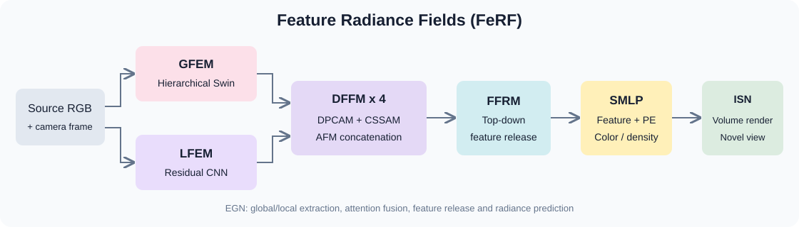

# FeRF

## [Paper] Feature radiance fields (FeRF): A multi-level feature fusion method with deep neural network for image synthesis

A modular PyTorch implementation accompanying the FeRF paper by Jubo Chen, Xiaosheng Yu, Chengdong Wu, Xiaolei Tian, and Ke Xu, published in **Applied Soft Computing, 167 (2024), 112262**.

[Paper](https://doi.org/10.1016/j.asoc.2024.112262) | [Reproduction notes](docs/REPRODUCTION.md) | [Dataset preparation](docs/DATASETS.md)

This project implements the architecture described in the paper. It is a paper-guided implementation with documented engineering choices, rather than a claim of numerical equivalence to the original experiments. No author checkpoint or benchmark result is included. The organization and README presentation follow the research repository style of [SMCL](https://github.com/jubo-neu/SMCL).

### Graphical overview



## Highlights

- **Dual feature extraction:** a hierarchical Swin Transformer GFEM captures contextual information; a five-block residual CNN LFEM preserves local details.
- **Attention fusion:** four DFFM blocks combine dual-path channel attention (DPCAM), cross-stacked spatial attention (CSSAM), and attention fusion (AFM).
- **Feature release:** a three-stage top-down FFRM integrates multi-resolution fused features.
- **Novel-view synthesis:** source-image features condition a small radiance MLP and differentiable coarse/fine volume rendering.
- **Complete workflow:** data conversion, camera validation, training, checkpoint recovery, evaluation, trajectory rendering, and CPU tests.

## Implementation status

- [x] GFEM, LFEM, DFFM, FFRM, and image-conditioned radiance field.
- [x] Stratified coarse sampling, inverse-CDF fine sampling, alpha compositing.
- [x] Training, warm-up, mixed precision on CUDA, validation, and resume.
- [x] Full-image PSNR and local-window SSIM; optional AlexNet LPIPS.
- [x] Dataset adapters, camera overlays, configuration files, and smoke scripts.
- [x] Offline CPU demonstration and automated tests.
- [ ] Full NMR/SRN/DTU benchmark training and published-score verification.

**Camera scope:** one source image conditions the model, but feature projection requires source intrinsics and a source camera frame; target rays require target camera parameters. A source camera can define the canonical coordinate frame if every target camera is expressed relative to it. This project does not estimate unknown camera poses from an arbitrary photograph. See [reproduction notes](docs/REPRODUCTION.md) for the paper's ambiguous use of "unposed."

## Project structure

```text
FeRF/
|-- train.py                  # Training entry point
|-- eval.py                   # Held-out scene/view evaluation
|-- render.py                 # Camera trajectory rendering
|-- ferf/
|   |-- models/
|   |   |-- swin.py           # Native / pretrained Swin GFEM
|   |   |-- local.py          # Five-block LFEM
|   |   |-- attention.py      # DPCAM + CSSAM + AFM
|   |   |-- pyramid.py        # FFRM
|   |   |-- encoding.py       # Fourier positional encoding
|   |   |-- field.py          # Small density/color MLP
|   |   `-- ferf.py           # EGN and feature projection
|   |-- rendering/            # Cameras, sampling, compositing, renderer
|   |-- data/                 # Scene archives and synthetic demo
|   |-- engine.py             # Training and evaluation loops
|   |-- checkpoint.py         # Checkpoints and RNG recovery
|   |-- metrics.py            # Image metrics
|   `-- utils.py
|-- configs/                  # smoke, NMR, SRN, DTU
|-- scripts/                  # Conversion, diagnostics, smoke workflows
|-- tests/
|-- docs/
`-- assets/
```

## Preparation for training

### 1. Environment

Python 3.10 or newer is required. Run commands from the repository root.

```bash
python -m venv .venv
# Linux/macOS:
source .venv/bin/activate
# Windows PowerShell instead:
# .venv\Scripts\Activate.ps1

python -m pip install --upgrade pip
# Install the PyTorch / torchvision combination suitable for your CUDA version first.
pip install -e ".[pretrained,metrics,dev,conversion]"
```

For an offline CPU demonstration without pretrained encoders or LPIPS:

```bash
pip install -e ".[dev]"
```

A CUDA 12.1 environment definition is also available:

```bash
conda env create -f environment.yml
conda activate ferf
pip install -e .
```

The native Swin implementation does not require timm or torchvision. The NMR/SRN/DTU configurations use timm Swin-T with ImageNet pretraining, which downloads weights on first use. LPIPS also downloads its AlexNet backbone on first use. Evaluation and rendering from a FeRF checkpoint do not re-download Swin weights.

### 2. Getting the data

The paper evaluates NMR ShapeNet, SRN Cars/Chairs, and DTU. Obtain data from their original distributors and preserve the official scene splits. Large datasets are not bundled. Convert each scene into a portable archive:

```text
data/nmr/
|-- train/
|   |-- object_000.npz
|   `-- object_001.npz
|-- val/
|   `-- object_100.npz
`-- test/
    `-- object_200.npz
```

Each archive contains `images [V,H,W,3]`, `K [V,3,3]` (or a shared `[3,3]` matrix), and `c2w [V,4,4]`. Camera axes are OpenCV: right, down, forward. Intrinsics use integer pixel centers. See [DATASETS.md](docs/DATASETS.md) for NMR, SRN, DTU/IDR, Blender, and manifest conversion commands and coordinate conventions.

```bash
python scripts/check_dataset.py --root data/nmr --output runs/nmr_data_check
```

Inspect the output cube overlays and camera distances before a long run. Set `near` and `far` according to your normalized scene scale. Default bounds are an engineering starting point, not a dataset-independent guarantee.

## Quick start: no dataset download

```bash
python scripts/make_demo_data.py --output data/demo --size 32
python -m pytest -q
python train.py --config configs/smoke.yaml --device cpu
python eval.py --checkpoint runs/smoke/latest.pt --device cpu --limit 2 --output runs/smoke/eval
python render.py --checkpoint runs/smoke/latest.pt --scene data/demo/test/test_000.npz --device cpu --gif --output runs/smoke/render
```

Or run `bash scripts/smoke_test.sh` on Linux/macOS, or `powershell -ExecutionPolicy Bypass -File scripts/smoke_test.ps1` on Windows from the repository root. The demonstration creates independent colored-ellipsoid scenes, trains for four steps, evaluates two images, and renders four views. It checks pipeline operation; four steps do not produce a trained novel-view model.

## Training

```bash
python train.py --config configs/nmr.yaml --device cuda
python train.py --config configs/srn.yaml --device cuda
python train.py --config configs/dtu.yaml --device cuda
```

Edit dataset roots and output paths in the configurations, or override them:

```bash
python train.py --config configs/nmr.yaml --data-root /path/to/nmr --output runs/my_nmr --device cuda
```

The paper-scale presets use 2,048 rays per image, 64 coarse samples, 128 additional fine samples, Adam with `betas=(0.9,0.999)` and `eps=1e-7`, encoder learning rate `1e-5`, head learning rate `1e-4`, 10,000 warm-up steps, and 500,000 optimizer steps. Swin uses its pretrained standard channel widths `[96,192,384,768]`. LFEM width, SMLP size, bounds, and some fusion details are configurable implementation choices.

Training samples a source and a different target view from each selected scene. RGB MSE supervises rendered rays. When fine sampling is enabled, both coarse and fine passes receive a loss. The two passes share the radiance field parameters. The source encoder is computed once per step.

### Resume training

```bash
python train.py --config configs/nmr.yaml --resume runs/nmr/latest.pt --device cuda
```

`--steps` sets the **total** target step count, including completed steps. Checkpoints contain model, optimizer, AMP scaler, configuration, step, and Python/NumPy/PyTorch RNG states. Resume expects the same model, data, rendering, and core optimization settings. CUDA kernels may still be nondeterministic across hardware or library versions.

### Outputs

```text
runs/nmr/
|-- config.json
|-- train.jsonl               # Step, loss, ray PSNR, learning rate
|-- latest.pt                 # Atomically replaced checkpoint
`-- validation/
    |-- 0005000.png
    `-- 0005000.json
```

Periodic validation renders the first held-out validation pair as a quick diagnostic. Use `eval.py` for the full evaluation protocol. If memory is insufficient, reduce `rays_per_image` or `batch_size`, then reduce `query_chunk`. Query chunking reduces temporary field allocations but retains training activations for backward; it does not guarantee arbitrary ray batches will fit. `ray_chunk` controls full-image inference memory. Report changed settings in any benchmark comparison.

## Test

```bash
python eval.py --checkpoint runs/nmr/latest.pt --split test --source-view 0 --output runs/nmr/eval --device cuda --lpips
```

Evaluation fixes one source view per test scene and visits every other view. On a 24-view NMR scene, this produces 23 targets. It exports prediction and target PNGs plus `metrics.json` with per-view, per-scene, mean-over-views, and mean-over-scenes scores. PSNR uses RGB values in `[0,1]`; SSIM uses an 11x11 Gaussian window with sigma 1.5 and valid convolution. LPIPS uses AlexNet and inputs scaled to `[-1,1]`. Without `--lpips`, no LPIPS result is reported. `--limit` is for debugging and must be omitted for complete benchmark evaluation.

## Novel-view rendering

Render the scene's existing cameras:

```bash
python render.py --checkpoint runs/nmr/latest.pt --scene data/nmr/test/object_200.npz --source-view 0 --output runs/nmr/render --device cuda --gif
```

Render a custom trajectory:

```bash
python render.py --checkpoint runs/nmr/latest.pt --scene data/nmr/test/object_200.npz --trajectory trajectory.npz --output runs/nmr/trajectory --device cuda --gif
```

`trajectory.npz` must contain OpenCV `c2w [T,4,4]` in the **same world frame and scale** as the source scene, plus optional pixel-space `K [T,3,3]` or `[3,3]`. When omitted, source intrinsics are reused. Images have the checkpoint resolution. Outputs include RGB frames, raw depth/opacity archives, and an optional animated GIF. Depth is the unnormalized expected distance along the ray (`sum(weights * t)`); background rays have zero depth. Opacity is accumulated ray weight.

## Results and reproducibility

The included CPU workflow verifies integration and numerical properties. See [VALIDATION.md](docs/VALIDATION.md) for the actual checks performed. No full-scale dataset training has been performed as part of this release, and no reproduction PSNR/SSIM/LPIPS benchmark is asserted. Paper results should be cited from the publication, not presented as results of these checkpoints.

## Citation

```bibtex
@article{chen2024feature,
  title={Feature radiance fields (FeRF): A multi-level feature fusion method with deep neural network for image synthesis},
  author={Chen, Jubo and Yu, Xiaosheng and Wu, Chengdong and Tian, Xiaolei and Xu, Ke},
  journal={Applied Soft Computing},
  volume={167},
  pages={112262},
  year={2024},
  doi={10.1016/j.asoc.2024.112262}
}
```

## Acknowledgements

This implementation follows the FeRF paper and draws on the published concepts of Swin Transformer, residual CNNs, attention fusion, feature pyramids, and NeRF volume rendering. The README organization references [SMCL](https://github.com/jubo-neu/SMCL). No SMCL implementation source or pretrained weights are redistributed here.
